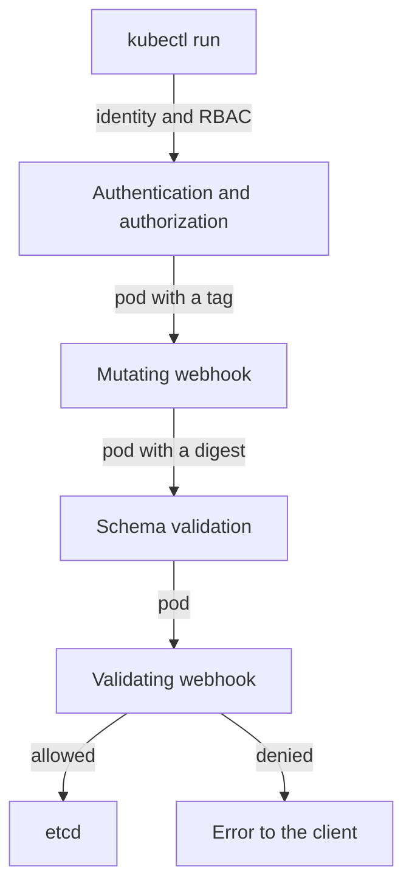

# Admission Webhooks And The Policy Controller Flow

Before you trust a webhook to stop bad images, you need to know where in the API server it runs and what it can see. This part follows one pod through the API server and the two webhooks Policy Controller installs. It also shows the tool you will use on every page from now on: a server-side dry run, which asks for the webhooks' decision without starting anything.

## Where admission happens

When you run `kubectl apply` or `kubectl run`, the Kubernetes API server does not store the pod at once. The API server is the component that accepts every write to the cluster and saves it in etcd, the cluster's database. It handles the request in a fixed order, and two of the steps call out to admission webhooks.

An **admission webhook** is an HTTPS service that the API server calls before it stores an object. A **mutating** webhook may change the object, for example to rewrite a field. A **validating** webhook may only allow or refuse it. The API server calls every mutating webhook first, then checks the object against its schema, then calls every validating webhook.



The diagram shows the pod passing the mutating webhook, which replaces the tag with a digest, and then the validating webhook, which allows it into etcd or returns an error.

Policy Controller registers one webhook of each kind, both named `policy.sigstore.dev`. List the webhook configurations in the playground to see them:

<!-- astrona:playground:renew -->

```sh
kubectl get mutatingwebhookconfigurations,validatingwebhookconfigurations | grep sigstore
```

The list shows `policy.sigstore.dev` once as a mutating and once as a validating webhook configuration. It also shows two more configurations with `clusterimagepolicy` in their names. Those check the `ClusterImagePolicy` resources themselves when you apply them; they never see a pod.

## What the two webhooks do to a pod

The two webhooks split the work. The mutating webhook resolves every image reference in the pod to a digest. A digest is the SHA-256 hash of the image manifest, written as `@sha256:...`; it names exactly one image, while a tag such as `:6.15.0` can be moved to another image at any time. Policy Controller writes the digest into the pod, so the image the node starts later is the same image it checked.

The validating webhook then checks each image by its digest. It finds every `ClusterImagePolicy` whose image patterns match the image, and checks the signatures and attestations each of those policies asks for. Every matching policy must pass, so two policies on the same image both apply.

Look up the digest of the signed image yourself. The `ws` helper runs a command in the workstation pod, where `regctl` lives:

```sh
ws() { kubectl -n workstation exec -i deploy/workstation -- "$@"; }
ws regctl image digest registry.localtest.me:5001/inventory/podinfo:6.15.0
```

`regctl` prints one line that starts with `sha256:`. That is the value the mutating webhook will write into a pod that asks for the tag `6.15.0`.

## Which pods the webhooks see

Both webhook configurations carry a namespace selector. A namespace selector is a label query on the namespace of the object; the API server only calls the webhook for objects in namespaces that match it. Print the selector of the validating webhook:

```sh
kubectl get validatingwebhookconfiguration policy.sigstore.dev \
  -o jsonpath='{.webhooks[0].namespaceSelector}{"\n"}'
```

The selector asks for the label `policy.sigstore.dev/include` with the value `true`. A namespace without that label never reaches Policy Controller, whatever policies exist.

## Asking for a decision with a dry run

The cluster's node cannot pull images from the lab registry, so a real pod would fail later with an image pull error. You do not need a running pod to learn the webhooks' decision, though. A **server-side dry run** (`--dry-run=server`) sends the request through every step of the API server, including the admission webhooks, and then stores nothing. Policy Controller's webhooks declare that they have no side effects, which is what allows the API server to call them during a dry run.

Create a namespace for experiments, opt it in, and ask for a pod with the signed image by its tag:

```sh
kubectl create namespace demo
kubectl label namespace demo policy.sigstore.dev/include=true
kubectl -n demo run check --image=registry.localtest.me:5001/inventory/podinfo:6.15.0 \
  --dry-run=server -o jsonpath='{.spec.containers[0].image}{"\n"}'
```

The command succeeds, and the image it prints is no longer the tag you typed. It ends in `@sha256:` and the digest you looked up with `regctl`: the mutating webhook replaced the tag, and the validating webhook found a valid signature from the lab key.

Now ask for the unsigned image in the same namespace:

```sh
kubectl -n demo run check --image=registry.localtest.me:5001/inventory/podinfo:6.14.1 \
  --dry-run=server
```

This time `kubectl` prints an error from the admission webhook `policy.sigstore.dev`. The message names the image by digest and the policy `inventory-signed`, and says that no valid signature was found for its authority. The API server stored nothing, and nothing was pulled.

You now know where Policy Controller sits: a mutating webhook that pins every image to a digest, and a validating webhook that checks the digest against every matching policy, both only for namespaces that opt in. The open question is what happens around the policies: in namespaces that do not opt in, for images that no policy matches, and when the webhook itself is down.

## Common pitfalls

> [!WARNING]
> - **Testing in a namespace without the label.** The API server never calls the webhook there, so every image is admitted and the test proves nothing.
> - **Reading a dry run as a running pod.** `--dry-run=server` returns the admission decision only. A real pod also needs the node to pull the image.
> - **Signing a tag and deploying a different image under the same tag.** Policy Controller checks the digest it resolved at admission time, so the signature must belong to that digest.
> - **Expecting one passing policy to be enough.** Every `ClusterImagePolicy` that matches an image must pass.
