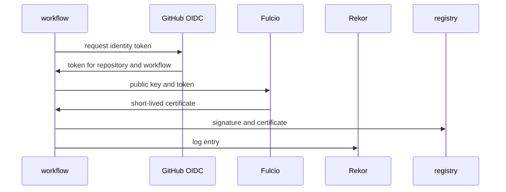

# Keyless Signatures And The Identity In The Certificate

You cannot write a keyless policy until you know what identity to require, and the identity is written inside the signature itself. This part explains how a keyless signature is made, and then reads and checks the identity of a real public image with `cosign verify`.

## How a keyless signature is made

Keyless signing still uses a key pair, but only for a few seconds. The signer creates a fresh key pair in memory, signs the image, and throws the private key away. What makes the signature trustworthy is a certificate that binds the public key to an identity.

Three services take part. The signer first gets an **OpenID Connect (OIDC) identity token**, a signed JSON Web Token from an identity provider that says who the signer is. In GitHub Actions, the workflow gets this token from GitHub without any stored secret. **Fulcio**, Sigstore's certificate authority, checks the token and issues an X.509 certificate for the fresh public key that is valid for about ten minutes. **Rekor**, Sigstore's transparency log, records the signature and the certificate, so the signature can be checked later, long after the certificate has expired.



The diagram shows the workflow trading its GitHub identity token for a certificate from Fulcio, storing the signature in the registry and recording it in Rekor.

## What the certificate says

Fulcio copies two facts from the token into the certificate. The **issuer** is the URL of the identity provider that issued the token; for GitHub Actions it is `https://token.actions.githubusercontent.com`. The **subject** is who the token was for; Fulcio writes it into the certificate's Subject Alternative Name (SAN). For a GitHub Actions workflow, the subject is a URL made of the repository, the workflow file and the Git reference it ran on:

```
https://github.com/stefanprodan/podinfo/.github/workflows/release.yml@refs/tags/6.10.0
```

This subject names the repository `stefanprodan/podinfo`, the workflow file `release.yml`, and the tag `6.10.0` the workflow ran for. A different repository, a different workflow file, or a run on a branch gives a different subject. That is what makes the identity useful: it is far narrower than "anyone who has the key".

## Read and check a real identity

The podinfo release workflow signs each release image keylessly. Open a shell in the workstation pod:

<!-- astrona:playground:renew -->

```sh
kubectl -n workstation exec -it deploy/workstation -- sh
```

Verify the image with the exact identity of its release run:

```sh
cosign verify ghcr.io/stefanprodan/podinfo:6.10.0 \
  --certificate-identity https://github.com/stefanprodan/podinfo/.github/workflows/release.yml@refs/tags/6.10.0 \
  --certificate-oidc-issuer https://token.actions.githubusercontent.com
```

`cosign` downloads the public-good trust root, finds the signature, checks the certificate chain up to Fulcio's root, checks the Rekor entry, and compares the identity. It reports that the claims were validated and that the certificate identity and issuer match, then prints the verified payload. The signature was made with cosign v3 in the Sigstore bundle format, which `cosign verify` v3 reads by default.

Now require the identity of a different repository on the same image:

```sh
cosign verify ghcr.io/stefanprodan/podinfo:6.10.0 \
  --certificate-identity-regexp '^https://github\.com/fluxcd/' \
  --certificate-oidc-issuer https://token.actions.githubusercontent.com
```

This fails: the signature is valid, but its subject does not match the expression. Run the reverse test on the Flux image, which the Flux project signed in its own workflows:

```sh
cosign verify ghcr.io/fluxcd/source-controller:v1.9.6 \
  --certificate-identity-regexp '^https://github\.com/stefanprodan/podinfo/' \
  --certificate-oidc-issuer https://token.actions.githubusercontent.com
```

It fails for the same reason. Both images carry perfectly valid keyless signatures; what separates them is only the identity. Leave the shell with `exit`.

> [!TIP]
> When you do not know a project's signing identity, read its release workflow file in the repository: the file path and the event that triggers it (tags or a branch) make up the subject. Then confirm it with `cosign verify` and an exact `--certificate-identity` before you put it in a policy.

You now know what a keyless signature proves: that a certificate authority checked an identity token for a specific issuer and subject at signing time, and that the event is in the transparency log. The open question is how to make Policy Controller require one particular identity.

## Common pitfalls

> [!WARNING]
> - **Checking only that a signature exists.** Every public image signed in any GitHub workflow has a valid keyless signature; only the identity tells them apart.
> - **Forgetting the issuer.** A subject alone can be matched by a token from another identity provider that uses the same text.
> - **Expecting the certificate to be valid now.** It expired minutes after signing; the transparency log entry proves it was valid when the signature was made.
> - **Requiring the exact tag in the subject for every release.** Each release runs on a new tag, so the subject changes; policies usually match the tag part with a regular expression.
