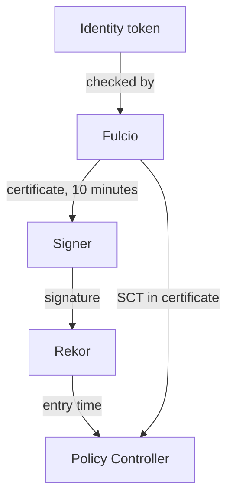

# Inside A Fulcio Certificate

A keyless policy trusts a certificate, so it helps to know exactly what the certificate holds and why it can be trusted after it has expired. This part reads the facts that Fulcio puts into a certificate, explains why the certificate lives only minutes, and shows the role of the two logs that make an old signature checkable.

## The facts in the certificate

Fulcio is the certificate authority of Sigstore. It receives an identity token from a provider, checks it, and signs a certificate for a public key that the signer made a moment before. The certificate is an X.509 certificate, the standard format for a public key with a name attached to it. Two places in it matter most.

The **Subject Alternative Name** (SAN) holds the subject: the workflow URL for a GitHub Actions run, or an email address for a person. A **certificate extension** is an extra field identified by a number, an object identifier (OID). Fulcio uses a family of extensions that start with `1.3.6.1.4.1.57264.1`. The extension `.1.1` is the original issuer field and `.1.8` is the newer form of it. The other extensions describe where the code came from: the extension `.1.12` is the source repository URL, `.1.14` the Git reference, `.1.13` the commit, `.1.9` the URL of the workflow that signed, and `.1.20` the event that triggered the run, such as a push.

Read these facts for a real image. Cosign prints them after a successful verification, under the key `optional`:

<!-- astrona:playground:renew -->

```sh
kubectl -n workstation exec deploy/workstation -- sh -c "cosign verify ghcr.io/stefanprodan/podinfo:6.10.0 \
  --certificate-identity https://github.com/stefanprodan/podinfo/.github/workflows/release.yml@refs/tags/6.10.0 \
  --certificate-oidc-issuer https://token.actions.githubusercontent.com 2>/dev/null | jq '.[0].optional'"
```

The output lists the issuer and the subject, and, for a GitHub Actions run, the workflow name, the repository, the Git reference and the commit that built the image. A policy can only match the issuer and the subject. The other facts are for people and for tools that audit builds.

## Why the certificate lives for minutes

A private key that lasts for years can leak. Fulcio avoids that problem: its certificates are valid for ten minutes. The signer uses the key once, then deletes it. There is nothing left to steal.

The consequence is that every certificate is expired by the time a cluster checks it. The cluster therefore cannot ask "is this certificate valid now?". It asks "was this certificate valid when the signature was made?". Two records answer that question.

## The two logs

Fulcio publishes every certificate it signs to a **certificate transparency log**, and it embeds a **signed certificate timestamp** (SCT) in the certificate. The SCT is a promise from the log that it has recorded the certificate. A verifier that sees a certificate without a valid SCT rejects it. This stops Fulcio from signing certificates in secret.

Rekor, the **transparency log** for signatures, records each signature together with the time. The log is append-only and gives a proof that an entry is included. When Policy Controller checks a keyless signature, it takes the time of the Rekor entry and confirms that the certificate was valid at that time. That is why a keyless authority with the public-good instance needs the Rekor log, and why a keyless policy needs internet access from the webhook unless you run your own Sigstore services.



The diagram shows the token, the short certificate and the signature, with Rekor supplying the time and the SCT proving that Fulcio logged the certificate.

You can now say what a keyless certificate proves and why it still verifies months later. The remaining question is which identity strings different providers produce.

## Common pitfalls

> [!WARNING]
> - **Checking certificate dates by hand and calling the signature expired.** The certificate is always expired. The Rekor time is the one that matters.
> - **Assuming the extensions are matched by a policy.** A keyless identity matches the issuer and the subject only.
> - **Running keyless policies in a cluster without internet access and without a private Sigstore.** The webhook cannot fetch the trust root, so every check fails.
> - **Reading `optional` fields as proof.** They come from the certificate, and they are only as trustworthy as the checks that accepted the certificate.
